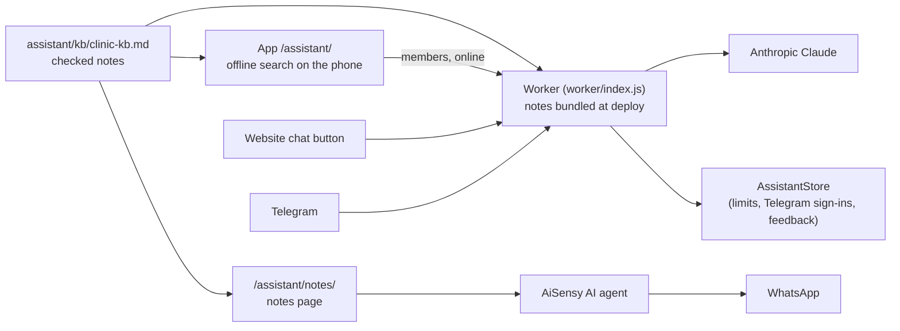

# Clinic Assistant: Set-Up and Running Guide

The Clinic Assistant serves members of the Digital & AI Fluency Clinic for Healthcare Professionals in four places, all fed by one set of checked notes (`assistant/kb/clinic-kb.md`).

| Channel | Who can use it | What it does | Where it lives |
|---|---|---|---|
| **App** (installable, works offline) | Notes: everyone. AI answers: members with a code | Searches the notes on the phone, even offline; members also get AI answers written only from the notes. Questions asked offline wait and are answered when the phone is back online. | `/assistant/` |
| **Website chat** | Every visitor (small daily limit); members get more with their code | A general-purpose assistant with detailed custom instructions, using the notes when a question is about the Clinic | Button on the home page (`assistant/widget.js`) |
| **Telegram bot** | Members, after sending their code once | The website chat's assistant, in Telegram, with short-term memory; works in groups with `/ask` | `/api/assistant/telegram` |
| **WhatsApp** | Anyone who messages the number | AiSensy's AI agent answering Clinic topics from the same notes | AiSensy; see [whatsapp-aisensy.md](whatsapp-aisensy.md) |

## What Is Where

| Path | Holds |
|---|---|
| `assistant/kb/clinic-kb.md` | **The notes.** Edit this to change what every channel knows. |
| `worker/prompts/general.md` | Custom instructions for the website chat and Telegram |
| `worker/prompts/grounded.md` | Instructions for notes-only answers in the app |
| `assistant/index.html`, `assistant/sw.js`, `assistant/manifest.webmanifest` | The installable app and its offline copy |
| `assistant/widget.js` | The website chat (one `<script>` line on any page) |
| `assistant/lib/` | Shared code for the browser and the Worker: note search, safe Markdown, identifier check |
| `assistant/privacy/` | Privacy notice (also needed for WhatsApp) |
| `worker/` | Server routes (not served as files) |
| `wrangler.jsonc` | Adds the Worker, its storage and the settings you may tune |

## One-Time Set-Up

### 1. Merge and Let It Deploy

Merging the pull request deploys as usual through Workers Builds. The first deploy also creates the Clinic Assistant's storage (a Durable Object) from the `migrations` entry in `wrangler.jsonc`; there is nothing to create by hand. The rest of the site keeps working as before: static files are still served directly.

### 2. Add the Secrets

Cloudflare dashboard > **Workers & Pages** > **cm-app-website** > **Settings** > **Variables and Secrets** > **Add**, type **Secret**:

| Name | Value |
|---|---|
| `ANTHROPIC_API_KEY` | Your Anthropic API key (the one your other tools use is fine) |
| `ASSISTANT_CODES` | Member codes, separated by commas: `CLINIC-2026` for one shared code, or labelled codes such as `batch1=AB12-CD34, faculty=EF56-GH78` |
| `ADMIN_KEY` | A long random string (for example 32 letters and digits). It opens the admin pages and also salts the stored hashes, so changing it later signs Telegram members out (they send their code again). |
| `TELEGRAM_BOT_TOKEN` | Added in step 4 |

Secrets survive every deploy. Do not put them in `wrangler.jsonc` or any file. From a terminal, `npx wrangler secret put ANTHROPIC_API_KEY` does the same.

Check: open https://dr-abhishekpanda-cm.app/api/assistant/status. It should show `"ai": true` and `"membersEnabled": true`.

### 3. Fill the Placeholders in the Notes

Open `assistant/kb/clinic-kb.md` on GitHub (the pencil icon works on a phone). Lines containing `[INSERT: ...]` stay hidden from users and from the AI until you replace them: the group and channel links, how members get a code, the Telegram and WhatsApp links, the ready-reckoner and session links.

### 4. Telegram

1. In Telegram, open **@BotFather**, send `/newbot`, give the name `Clinic Assistant` and a username ending in `bot`.
2. Copy the token BotFather sends and add it as the secret `TELEGRAM_BOT_TOKEN`.
3. Open `https://dr-abhishekpanda-cm.app/api/assistant/admin/telegram-setup?key=YOUR_ADMIN_KEY` once. It connects the bot to the site (with a secret header so only Telegram can call it), and sets the bot's commands and description. The reply shows the bot's link.
4. Share the link with members. A start link that carries the code saves them a step: `https://t.me/YourBot?start=CLINIC-2026`.
5. Optional, in BotFather: `/setuserpic` for the icon (`assistant/icon-512.png`).

Members send `/code THEIR-CODE` once; after that every message in a private chat is a question. In a group, the bot answers `/ask question` and replies to its own messages, and ignores everything else.

### 5. WhatsApp (AiSensy)

Follow [whatsapp-aisensy.md](whatsapp-aisensy.md). It needs no code: AiSensy's agent reads the notes page.

## Everyday Running

### Editing Notes and Instructions

- **Notes:** edit `assistant/kb/clinic-kb.md`. One `## Title` per note, optional `tags:` with words people may type, `status: draft` to hide a note. After the next deployment (a few minutes) the website chat and Telegram use the new notes, and the app downloads them the next time it opens online. Re-sync the notes page in AiSensy after big changes.
- **Custom instructions:** edit `worker/prompts/general.md` (website and Telegram) or `worker/prompts/grounded.md` (app).
- **App code:** if you change `assistant/index.html` or the files in `assistant/lib/`, change `VERSION` in `assistant/sw.js` so installed apps pick up the new code. Notes do not need this.

### Limits and Models

Change these in `wrangler.jsonc` under `"vars"`:

| Setting | Default | Meaning |
|---|---|---|
| `MODEL_GENERAL` | `claude-haiku-5-5` | Model for the website chat and Telegram |
| `MODEL_GROUNDED` | `claude-haiku-5-5` | Model for notes-only answers in the app |
| `WEBSITE_OPEN` | `true` | `false` makes the website chat members-only |
| `OPEN_DAILY_PER_DEVICE` | 15 | Free messages a visitor's device gets each day |
| `OPEN_DAILY_PER_IP` | 60 | Free messages one network (for example a college Wi-Fi) gets each day |
| `OPEN_DAILY_TOTAL` | 300 | Free messages all visitors together get each day: your cost ceiling for the open chat |
| `MEMBER_DAILY_PER_USER` | 40 | AI messages a member gets each day (per device, or per Telegram account) |
| `MEMBER_DAILY_TOTAL` | 2000 | AI messages all members together get each day |
| `KEEP_DAYS` | 60 | Days to keep unanswered questions and feedback |

Days run on Indian Standard Time; limits reset at midnight.

### Cost

You pay Anthropic for tokens; Cloudflare's free plan covers the Worker and its storage at this scale.

- A typical answer uses about 2,000 to 3,500 input tokens (instructions plus matching notes plus the question) and 200 to 400 output tokens. The fixed instructions are marked for prompt caching, which lowers the input cost of repeated requests.
- So 1,000 answers use roughly 2.5 to 3.5 million input tokens and 0.3 million output tokens. Multiply by the model's price per million tokens on Anthropic's pricing page.
- The daily totals above put a ceiling on spending. With the defaults, the open website chat can never exceed 300 answers a day.
- The admin usage page (below) shows the tokens used each day.

### Admin Pages

Bookmark these on your phone (replace `KEY` with your `ADMIN_KEY`):

| Page | Shows |
|---|---|
| `/api/assistant/admin/stats?key=KEY` | Answers per day by channel, and tokens used |
| `/api/assistant/admin/records?kind=unanswered&key=KEY` | Questions in the app that no note could answer: your list of notes to write |
| `/api/assistant/admin/records?kind=feedback&key=KEY` | Answers marked "Not right", and Telegram `/feedback` |

Without the right key these pages answer "not found".

### Codes

Change `ASSISTANT_CODES` to add or withdraw codes; it takes effect at once. Telegram members whose code is withdrawn must enter a valid code again. A code is case-insensitive and needs at least 4 characters.

## Privacy and Safety, in Short

- No patient-identifiable numbers reach the AI: the app, the website chat, the Worker and the Telegram bot all refuse messages that look like mobile, Aadhaar, ABHA or hospital record numbers. Names cannot be detected, so every channel also tells people not to share them.
- The Worker keeps no message text except questions the notes could not answer (app) and "Not right" reports, both deleted after 60 days. Devices, networks and Telegram accounts are stored only as salted one-way hashes. Telegram conversation context is kept for 6 hours.
- The app keeps the user's questions on their own phone only.
- The WhatsApp agent is limited to Clinic topics, as Meta's terms require.
- `assistant/privacy/` explains all of this to users. Update it if you change what is kept.
- The pull request also stops `.git`, `wrangler.jsonc` and other repository files from being uploaded as public website files.

## Testing

From the repository root (Node 22; no packages to install in the repository):

| Test | Command |
|---|---|
| Notes, search, Markdown and identifier check | `node --test worker/test/core.test.mjs` |
| Every server route, with stand-in Claude and Telegram | `node --test worker/test/integration.test.mjs` |
| The app and the website chat in a real browser, including offline | `node worker/test/e2e.mjs --shots /tmp/shots` |

The last two start `wrangler dev` (through `npx wrangler`, or set `WRANGLER` to a wrangler binary) and need no keys. The browser test uses the Playwright installed on the machine (set `PLAYWRIGHT` and `CHROME` if needed), as the apps-src tests do.

## If Something Goes Wrong

| Symptom | Check |
|---|---|
| "AI answers are not switched on yet" | `ANTHROPIC_API_KEY` secret missing; `/api/assistant/status` shows `"ai": false` |
| "The assistant is not set up correctly yet (AI key)" | The key is wrong or has no credit |
| "The AI service could not process this message" | A model name in `MODEL_GENERAL` or `MODEL_GROUNDED` is wrong |
| Telegram bot silent | Run the telegram-setup page again; it re-registers the webhook |
| Old app screens after an update | Change `VERSION` in `assistant/sw.js` |
| Deploy fails mentioning Durable Objects | Workers Free supports SQLite-backed Durable Objects; check the account's Workers plan and the `migrations` block |
